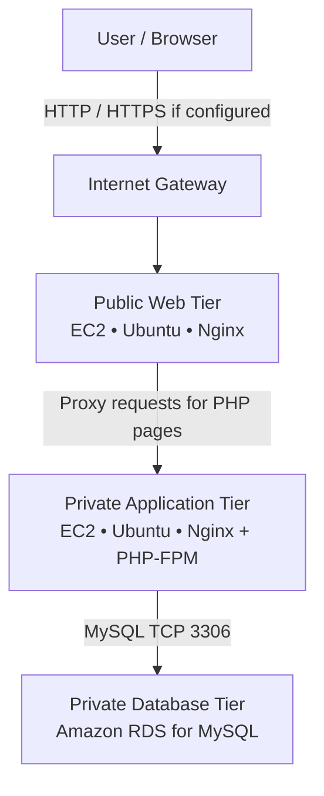

# AWS Three-Tier Architecture
### A hands-on cloud learning project

This repository documents a practical AWS project built while learning cloud computing, Linux, networking, and DevOps fundamentals. It demonstrates a web registration form, an application server, and a managed MySQL database connected through AWS networking.

## Architecture



The diagram represents the intended request path. Confirm that your live Nginx configuration, routes, and security groups match it. HTTPS is not implied unless you have configured TLS.

## Project components

| Component | Purpose |
|---|---|
| Web tier | Public-facing Ubuntu EC2 instance running Nginx |
| Application tier | Private Ubuntu EC2 instance serving PHP through Nginx and PHP-FPM |
| Database tier | Amazon RDS for MySQL in private database subnets |
| VPC and subnets | Isolate and organize the three tiers |
| Internet Gateway | Internet routing for the public web subnet |
| NAT Gateway | Optional outbound internet access for private instances |
| Security groups | Restrict traffic between the tiers |
| Bastion host | Optional administrative access path to private instances |

## Request flow

1. A user opens `register.html` on the web server.
2. The form sends a `POST` request to `submit.php`.
3. The web-tier Nginx configuration proxies PHP requests to the private application server.
4. PHP validates the submitted fields and hashes the password.
5. The application server inserts the registration into Amazon RDS for MySQL using a prepared statement.
6. A success or error response is returned to the browser.

## Repository structure

```text
aws-three-tier-architecture/
├── README.md
├── .gitignore
├── architecture/
│   └── README.md
├── web-tier/
│   └── nginx.conf.example
├── app-tier/
│   ├── register.html
│   ├── submit.php
│   ├── config.php.example
│   └── nginx-app.conf.example
├── database/
│   └── schema.sql
└── screenshots/
    ├── 01-vpc-resource-map.png
    ├── 02-ec2-servers.png
    ├── 03-rds-available.png
    ├── 04-rds-connectivity.png
    ├── 05-registration-form.png
    ├── 06-nginx-proxy-config.png
    ├── 07-rds-security-group.png
    └── 08-database-schema-and-test.png
```

## Database schema

The SQL schema is in [`database/schema.sql`](database/schema.sql). It creates `registration_db` and a `users` table. Usernames are unique to prevent duplicate registrations.

## Configuration before use

1. Copy `app-tier/config.php.example` to `app-tier/config.php` on the application server.
2. Set the RDS endpoint, database name, database username, and password in the private configuration file.
3. Do **not** commit `config.php` or real credentials.
4. Configure the app-tier Nginx server to pass PHP files to PHP-FPM.
5. Configure the web-tier Nginx server to proxy PHP requests to the application tier's private address.
6. Restrict security groups so that:
   - Web traffic reaches the public web tier only on the intended ports.
   - The application tier accepts web requests from the web-tier security group.
   - RDS accepts TCP `3306` only from the application-tier security group.
   - SSH is restricted to your administrative IP or a bastion host.

The example configuration files use placeholder values. Replace them with your actual paths, addresses, PHP-FPM socket, and ports.

## Security notes

- Passwords are hashed using PHP's `password_hash()` before storage.
- Database writes use a prepared statement.
- Database credentials belong in a server-side configuration file, not in public GitHub code.
- The included screenshots have been redacted to hide visible account details and personal registration/database values.
- The public demo URL shown in the original screenshot used HTTP. Do not use real credentials or sensitive data over plain HTTP. Configure HTTPS before exposing a real registration system.
- For production use, also add CSRF protection, rate limiting, stronger validation, secure session handling if sessions are introduced, and appropriate monitoring.

## Screenshots

The `screenshots/` folder contains redacted evidence from the AWS console and registration demo. The database screenshot is redacted so that registration values and password hashes are not exposed.

## What I practiced

- VPC, public/private subnets, route tables, Internet Gateway, and NAT Gateway concepts
- EC2 instance administration on Ubuntu
- Nginx reverse proxy configuration
- Security-group rules for tier-to-tier communication
- Amazon RDS for MySQL connectivity
- SQL database and table creation
- PHP form validation, password hashing, and prepared statements
- Troubleshooting and documenting a multi-tier cloud setup

## Learning approach

AI tools were used as coding and learning assistants. The focus of this project is to understand the infrastructure, review the code, test the configuration, and learn how the tiers communicate.

**Project:** AWS Three-Tier Architecture  
**Focus:** Cloud Computing, Linux, Networking, SQL, and DevOps fundamentals
